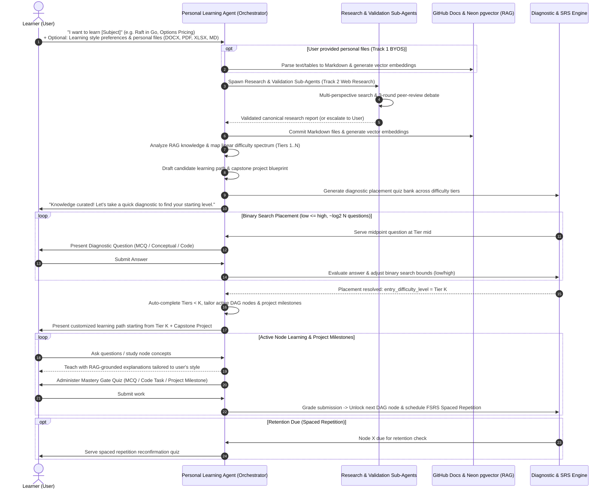
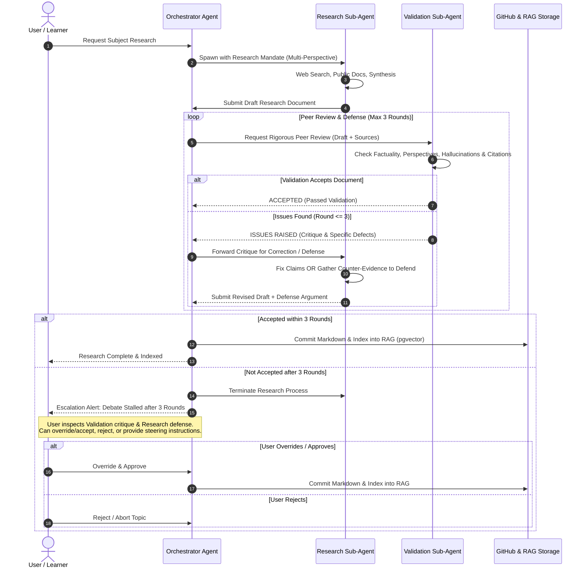
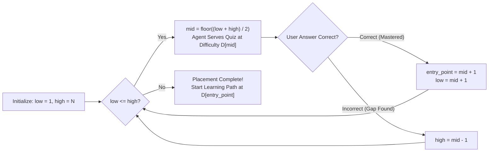
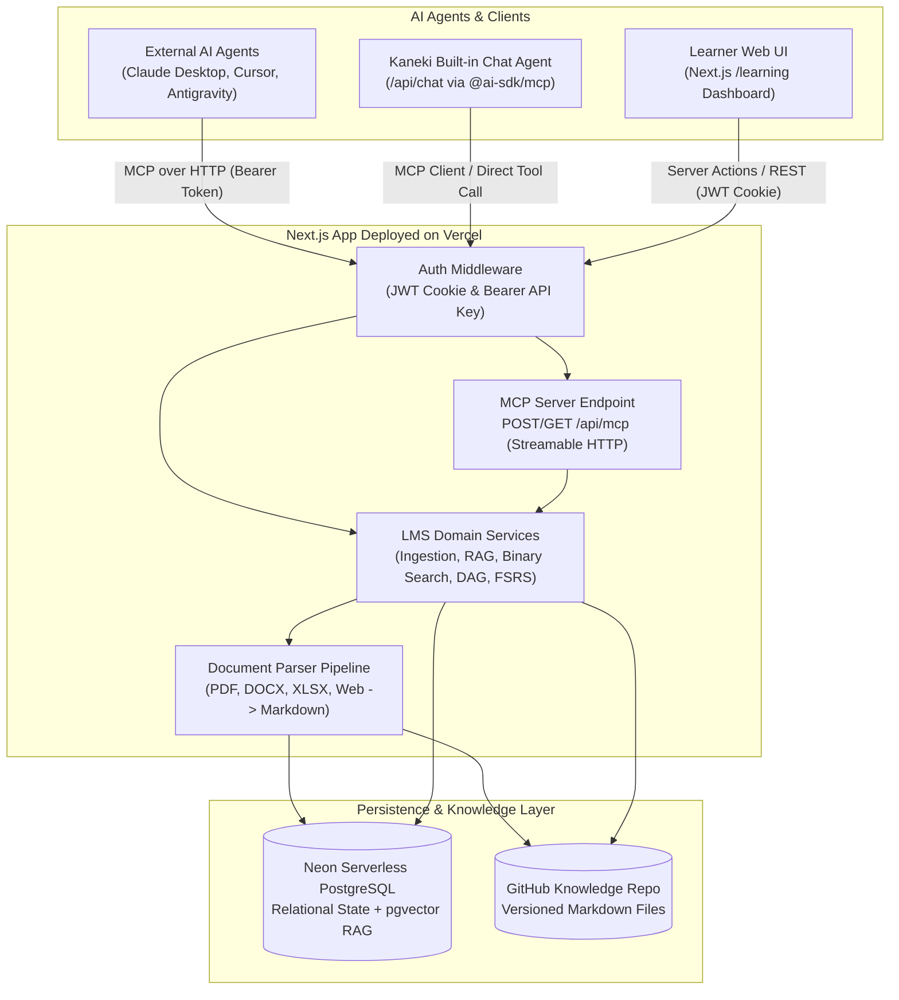
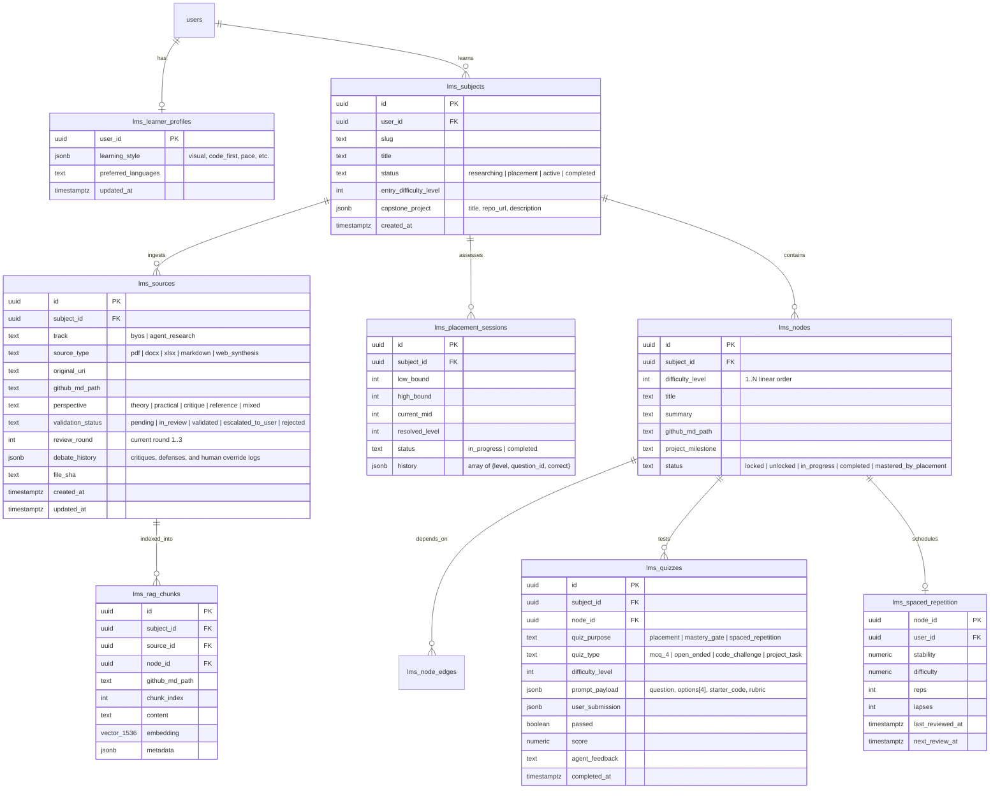
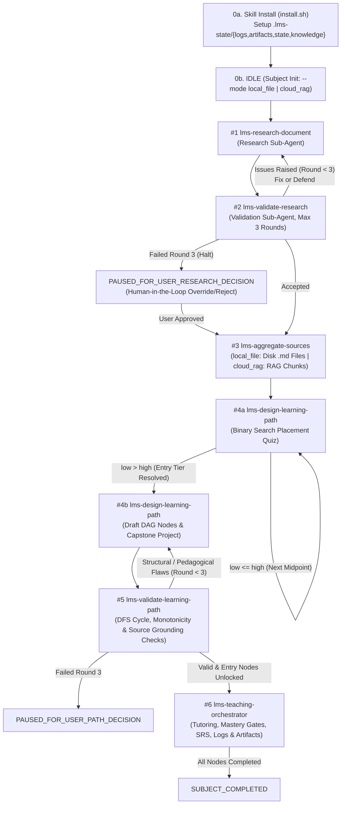

# My LMS — Agent-Driven Adaptive Learning Management System

## 1. Vision & Core Philosophy

**My LMS** (integrated into `my_kaneki` at `/learning`) is an **Agent-Driven, Personalized Learning Management System** built around a simple premise: every learner has a dedicated AI Agent tailored to their unique learning style, pace, and goals.

Instead of static, one-size-fits-all courses, the system dynamically:
1. **Researches & Curates Knowledge**: 
   - **Track 1 (Bring Your Own Sources - BYOS)**: User brings their own documents (`DOCX`, spreadsheets/`XLSX`/`CSV`, `PDF`, `Markdown`). The system parses, structures, and directly indexes them into the **RAG (Retrieval-Augmented Generation)** system.
   - **Track 2 (Agent Web Research & Peer-Review Loop)**: An **Orchestrator Agent** spawns a **Researching Sub-agent** to search the web across diverse perspectives, compiling an initial research document. A separate **Validation Sub-agent** critically inspects the findings. If issues are raised, the research agent can fix or defend its findings with counter-evidence in an open peer-review dialogue. If after **3 rounds of debate** the research is still not accepted, the agent stops and escalates to the **user for a final decision**. Once approved, the document is committed as Markdown and indexed into RAG.
2. **Pinpoints the Starting Level via Binary Search**: Evaluates the user's prior knowledge along a linearly ordered difficulty spectrum using a **Binary Search Diagnostic Quiz**, finding the exact knowledge boundary in $\mathcal{O}(\log N)$ steps.
3. **Drafts a Node-Based & Project-Driven Learning Path**: Generates a Directed Acyclic Graph (DAG) of atomic knowledge nodes starting from the user's entry point, ideally woven around building an **entire meaningful real-world project**.
4. **Enforces Mastery Gates & Spaced Repetition**: Requires passing subject-appropriate quizzes (4-option MCQs, conceptual Q&A, coding tasks, or project milestones) to travel from one node to the next, while scheduling **Spaced Repetition (FSRS / SM-2)** review quizzes to guarantee long-term retention.
5. **Exposes Everything as a Remote MCP Server on Vercel**: The Next.js web app deployed on Vercel functions as a **Model Context Protocol (MCP) Server** (`/api/mcp`), allowing internal or external AI agents (Claude, Cursor, Antigravity, or the built-in Kaneki Agent) to drive the entire learning lifecycle through standardized MCP Tools, Resources, and Prompts.

---

## 2. End-to-End Learning Lifecycle

### 2.1 Actor Interaction Sequence

The learning journey is strictly **agent-driven and conversational**: the user tells their personal agent what they want to learn; in response, the agent autonomously researches the domain, ingests resources, maps the difficulty continuum, drafts the learning path, and prepares the diagnostic quiz to find the learner's baseline.



---

### 2.2 Detailed Lifecycle Phases

#### Phase 1: Goal Initiation & Learner Persona Setup
- **User Prompt**: The user initiates a subject conversation with the agent (e.g., *"I want to master Raft Distributed Consensus and build a production-grade KV store in Go"*).
- **Learner Profile**: The agent retrieves or updates the user's cognitive style (e.g., *first-principles*, *analogy-heavy*, *code-first*, *visual/diagrammatic*), target depth, background experience, and time availability.
- **Optional File Ingestion**: The user can attach their own reference materials (`PDF`, `DOCX`, `XLSX`, `Markdown`).

#### Phase 2: Agent-Led Knowledge Ingestion & Multi-Agent Research System
Once the subject goal is set, the agent autonomously grounds itself in the domain:

##### Track 1: Bring Your Own Source (BYOS) Ingestion Pipeline
When the learner provides existing study materials:
- **Supported Formats**:
  - **Documents**: `.docx`, `.pdf`, `.md`, `.txt`
  - **Spreadsheets / Tables**: `.xlsx`, `.csv` (e.g., benchmark numbers, formula definitions, financial models)
- **Original File Storage & On-Demand RAG Extraction**:
  - The user's **original file** is committed directly as-is to GitHub under the subject's unified sources directory: `lms/<subject-slug>/sources/<original-filename>` (preserving `.pdf`, `.docx`, `.xlsx`, `.csv`, `.md`).
  - The directory's `lms/<subject-slug>/sources/metadata.json` file is updated to register the file with `owner: "user"`.
  - **No duplicate normalized `.md` file is written to GitHub for user files.** Text/table extraction to Markdown happens strictly in-memory when indexing chunks into **Neon PostgreSQL (`pgvector`)** (`lms_rag_chunks`), or is skipped entirely when normalization is not needed (e.g., native `.md`/`.txt` or non-RAG mode).

##### Track 2: Multi-Agent Web Research & 3-Round Peer-Review Validation Loop
When researching new topics or augmenting user notes with public information, the Personal Agent (acting as Orchestrator) initiates a multi-perspective research workflow using dedicated sub-agents:



- **Roles & Responsibilities**:
  1. **Orchestrator Agent**: Manages the lifecycle, tracks the review round counter ($1 \dots 3$), persists the debate transcript in the database, and enforces the escalation boundary.
  2. **Research Sub-Agent**: Gathers information across multiple perspectives (e.g., theoretical concepts, real-world implementations, edge cases, community critiques). It writes a structured research draft with concrete source citations.
  3. **Validation Sub-Agent**: Acts as an adversarial peer reviewer. It verifies whether claims have reputable sources, checks for contradictions or LLM hallucinations, and ensures multiple perspectives are fairly represented.
- **The 3-Round Debate & Defense Mechanism**:
  - If the Validation Agent flags inaccuracies, vague claims, or missing perspectives, it provides concrete feedback.
  - The Research Agent does not blindly overwrite: it has the agency to **fix** valid defects or **defend** its findings using additional primary sources and logical reasoning.
  - The Validation Agent is instructed to remain open-minded and re-assess the Research Agent's defense fairly.
  - **Strict Round Limit**: Up to **3 rounds** of critique $\leftrightarrow$ defense exchanges are permitted.
- **Human-in-the-Loop Escalation**:
  - If the two sub-agents cannot reach consensus by the end of Round 3, the Research Agent **must stop immediately**.
  - The research process halts and creates an `escalated_to_user` task in the UI.
  - The user can review the full debate transcript, inspect the disputed claims, and make the final decision: **Approve with edits**, **Override & accept**, or **Reject/Cancel**.
- **Storage & Indexing**:
  - Once validated (or approved by the user), the final synthesis is saved to `lms/<subject-slug>/sources/<topic-slug>.md` on GitHub, recorded in `lms/<subject-slug>/sources/metadata.json` with `owner: "agent_research"`, and chunked/embedded into the RAG vector store.

#### Phase 3: Curriculum Mapping & Binary Search Diagnostic Placement
Once the knowledge base is established, the Agent prepares the assessment pipeline before engaging the user:
1. **Linear Difficulty Spectrum**: The Agent analyzes the validated RAG documents and models the subject as a **linearly increasing difficulty array** $D = [d_1, d_2, \dots, d_N]$ (e.g., $N = 16$ or $32$ ordered micro-competencies from prerequisite basics to production subtleties).
2. **Diagnostic Quiz Preparation**: The Agent pre-synthesizes high-signal diagnostic questions for key difficulty checkpoints along that continuum.
3. **Interactive Binary Search**: The Agent engages the learner in a focused placement quiz to find their boundary:



- **Why Binary Search?**
  - For a curriculum of $N = 32$ ordered difficulty tiers, binary search identifies the learner's exact mastery boundary in **at most $\lceil \log_2(32) \rceil = 5$ questions**.
  - All nodes below `entry_point` are automatically marked as `mastered_by_placement` (avoiding repetitive basic lectures), and the active learning path begins directly at `D[entry_point]`.

#### Phase 4: Tailored Node-Based Path & Meaningful Capstone Project
Armed with the learner's exact starting level, the Agent finalizes the customized learning path:
- **Atomic Knowledge Nodes**:
  - Each node represents one focused, digestible concept (15–45 minutes of study) backed by specific Markdown documents in the RAG store.
  - Nodes form a **Directed Acyclic Graph (DAG)** where edges represent prerequisite dependencies ($Node_A \to Node_B$).
- **Project-Centric Learning (Capstone Thread)**:
  - The Agent designs an **overarching meaningful project** spanning the active learning path.
  - Each knowledge node contributes a concrete building block to that project (e.g., *Node 3: Implement WAL log framing* $\to$ *Node 4: Build leader election timer* $\to$ *Node 5: Replicate log entries*).
  - By the time the learner finishes the final node, they have both mastered the theory and built a complete, portfolio-grade project.

#### Phase 5: Mastery Gates & Variant Quiz Modalities
To travel from $Node_i$ to $Node_{i+1}$, the learner must pass a **Mastery Gate Quiz**. Because subjects vary widely, the quiz engine supports polymorphic question types:

| Modality | Structure | Best Suited For | Evaluation Mechanism |
| :--- | :--- | :--- | :--- |
| **Multiple Choice (`mcq_4`)** | 1 question stem + 4 options (`A`, `B`, `C`, `D`) + explanation | Conceptual checks, syntax, terminology, quick recall | Deterministic exact match |
| **Short Answer / Socratic (`open_ended`)** | Conceptual prompt or scenario analysis | System design trade-offs, architecture, theory | Rubric-based LLM-as-a-Judge grounded in RAG |
| **Coding Task (`code_challenge`)** | Problem prompt + starter code + test suite / constraints | Algorithms, APIs, debugging, language mechanics | Automated test runner / AST & rubric verification |
| **Project Milestone (`project_task`)** | Specification for a feature in the capstone project | Applied engineering, end-to-end integration | Git commit / diff inspection or artifact checklist |

#### Phase 6: Spaced Repetition (Long-Term Memory Retention)
Completing a node is only the first step. To combat the forgetting curve, every completed node enters a **Spaced Repetition Queue** (powered by the **FSRS** or **SM-2** algorithm):
- Each node tracks `stability`, `difficulty`, `elapsed_days`, `scheduled_days`, `reps`, `lapses`, and `next_review_at`.
- When `now >= next_review_at`, the node surfaces in the user's **Daily Review Queue**.
- The agent generates a fresh **Reconfirmation Quiz** (often a new variation or application of the concept so the user doesn't just memorize the previous question's phrasing).
- **Outcome**:
  - **Pass (Easy / Good)**: Interval expands exponentially (e.g., $1\text{d} \to 3\text{d} \to 7\text{d} \to 21\text{d} \to 60\text{d}$).
  - **Fail / Lapse**: Interval resets, node status flags `needs_refresher`, and the agent highlights the specific RAG note section to review.

---

## 3. System Architecture (MCP Server on Vercel)

The application is designed as a **Next.js App Router web application deployed on Vercel** that serves dual roles:
1. **Human Interface (`/learning`)**: Interactive visual learning graph, Markdown reader, quiz runner, project tracker, and spaced repetition dashboard.
2. **AI Agent Interface (`/api/mcp`)**: Stateless **Streamable HTTP MCP Server** allowing any authorized AI agent to inspect learner state, ingest files, run RAG searches, administer binary-search placement, and mutate the learning graph.



### Why Stateless Streamable HTTP MCP on Vercel?
Vercel Serverless / Fluid Compute functions are ephemeral. To make the MCP server reliable on Vercel:
- **Transport**: Uses MCP **Streamable HTTP** (`POST /api/mcp` for JSON-RPC requests/tool calls, with optional SSE streaming responses) rather than long-lived local `stdio` pipes.
- **Database-Backed State**: All session state (active placement binary search bounds `low`/`high`, current quiz session, learning path graph, FSRS schedules) is persisted in **Neon PostgreSQL**. Every MCP request is stateless at the compute layer and idempotent at the database layer.
- **Authentication**: Supports `Authorization: Bearer <KANEKI_MCP_API_KEY>` (or signed HS256 JWT tokens) so external agents and the internal Kaneki workspace agent authenticate securely as the workspace owner.

---

## 4. Data & Storage Architecture

### 4.1 File-Based Knowledge Base Structure (GitHub Repository)
All curated knowledge is organized by learning subject in the configured GitHub repository (reusing and extending `src/actions/github.ts`). Both user-uploaded original files and agent-researched documents live together under `lms/<subject-slug>/sources/`, with a `metadata.json` manifest tracking each file's owner (`user` vs `agent_research`) and attributes:

```text
lms/
└── <subject-slug>/
    ├── manifest.json                 # Subject metadata, project brief & DAG snapshot
    ├── sources/                      # Unified subject sources directory
    │   ├── metadata.json             # Tracks file list, owner ("user" | "agent_research"), type, sha, status
    │   ├── raft-extended.pdf         # User original file (stored as-is, no .md conversion file on repo)
    │   ├── benchmark-data.xlsx       # User original file (stored as-is)
    │   ├── personal-notes.md         # User original file
    │   ├── 01-multi-perspective.md   # Agent-researched synthesis (validated)
    │   └── 02-deep-dive-mechanics.md # Agent-researched synthesis (validated)
    ├── nodes/                        # Synthesized study guides per learning node
    │   ├── node-01-fundamentals.md
    │   ├── node-02-core-mechanics.md
    │   └── node-03-advanced-patterns.md
    └── project/                      # Capstone project specification & milestone guides
        ├── README.md
        └── milestones/
            ├── m1-scaffolding.md
            └── m2-core-engine.md
```

Example `lms/<subject-slug>/sources/metadata.json`:
```json
{
  "subjectSlug": "raft-consensus-go",
  "updatedAt": "2026-10-31T11:00:00Z",
  "files": [
    {
      "filename": "raft-extended.pdf",
      "path": "lms/raft-consensus-go/sources/raft-extended.pdf",
      "owner": "user",
      "sourceType": "pdf",
      "sha": "a1b2c3d..."
    },
    {
      "filename": "01-multi-perspective.md",
      "path": "lms/raft-consensus-go/sources/01-multi-perspective.md",
      "owner": "agent_research",
      "sourceType": "web_synthesis",
      "perspective": "mixed",
      "sha": "e4f5g6h..."
    }
  ]
}
```

### 4.2 Database Schema (Neon PostgreSQL + `pgvector`)



---

## 5. MCP Server Specification (`/api/mcp`)

The web app exposes an MCP server at `https://<your-vercel-domain>/api/mcp`. AI agents connect to this endpoint to orchestrate every stage of learning.

### 5.1 MCP Resources (Read-Only Context)
| Resource URI Pattern | Description |
| :--- | :--- |
| `lms://profile` | The learner's cognitive style, preferences, and active subjects. |
| `lms://subjects/{slug}/overview` | Subject status, capstone project specification, and current progress metrics. |
| `lms://subjects/{slug}/graph` | Full DAG of learning nodes, prerequisites, completion states, and difficulty tiers. |
| `lms://subjects/{slug}/nodes/{nodeId}` | The Markdown study guide and capstone milestone instructions for a specific node. |
| `lms://reviews/due` | List of completed nodes currently due for a Spaced Repetition quiz. |

### 5.2 MCP Tools (Agent Actions)

#### A. Profile & Subject Management
- `lms_get_or_update_learner_profile`: Read or update the user's learning style preferences, background skills, and goals.
- `lms_create_subject`: Initialize a new learning subject with an optional capstone project concept and linear difficulty scale ($1 \dots N$).

#### B. Knowledge Ingestion, Multi-Agent Research & Validation
- `lms_ingest_user_file` (Track 1 — BYOS): Ingests user-provided files (`.docx`, `.xlsx`, `.csv`, `.pdf`, `.md`), commits the **original file as-is** to GitHub (`lms/<slug>/sources/<filename>`), updates `lms/<slug>/sources/metadata.json` (`owner: "user"`), and— only when RAG indexing is needed—extracts text in-memory to chunk and embed into `lms_rag_chunks`.
- `lms_start_research_session` (Track 2 — Orchestrator): Initializes an agent-driven web research session for a subject topic, establishing multi-perspective research goals.
- `lms_submit_research_draft` (Track 2 — Research Sub-Agent): Submits the initial research draft or a revised draft along with counter-evidence / defense arguments addressing prior validation critiques.
- `lms_validate_research_draft` (Track 2 — Validation Sub-Agent): Evaluates the draft against source credibility, balance of perspectives, and factual consistency. Either marks as `accepted` or returns specific actionable defects, incrementing `review_round` (up to 3).
- `lms_resolve_research_escalation` (Track 2 — Escalation & User Decision): If after 3 rounds the document is still rejected, the agent halts and surfaces the debate to the user. Records the human user's decision (`approve_override`, `edit_and_approve`, or `reject`). Upon approval, commits the document to GitHub (`lms/<slug>/sources/<topic>.md`), updates `lms/<slug>/sources/metadata.json` (`owner: "agent_research"`), and triggers RAG embedding.
- `lms_search_rag`: Performs hybrid semantic (`pgvector` cosine similarity) + keyword search across the subject's validated Markdown knowledge base. Supports filtering by `subject_slug`, `track`, `perspective`, and `difficulty_level`.

#### C. Binary Search Placement Quiz
- `lms_placement_start`: Initialize a binary search diagnostic session for a subject with difficulty range $[1, N]$, setting `low = 1`, `high = N`, and returning the initial midpoint `mid = floor((1 + N) / 2)`.
- `lms_placement_submit_step`: Submit the learner's answer to the current midpoint question (`mid`).
  - Automatically evaluates correctness (deterministic for `mcq_4`, rubric-graded for open/code).
  - Updates binary search bounds:
    - If `passed == true`: `low = mid + 1`
    - If `passed == false`: `high = mid - 1`
  - Returns either the next `mid` difficulty level to test, or `{ status: "completed", entry_difficulty_level: low }` when `low > high`.

#### D. Learning Path (DAG) & Node Progression
- `lms_draft_learning_path`: Bulk-create or update the ordered knowledge nodes ($Node_1 \dots Node_K$), their DAG dependency edges, associated GitHub Markdown study guides, and capstone project milestones starting from `entry_difficulty_level`.
- `lms_get_next_nodes`: Retrieve currently `unlocked` or `in_progress` nodes along with their RAG study context.

#### E. Mastery Gate & Spaced Repetition Quizzes
- `lms_generate_quiz`: Create a quiz instance (`mastery_gate` or `spaced_repetition`) for a target node with the appropriate modality (`mcq_4`, `open_ended`, `code_challenge`, or `project_task`).
- `lms_submit_quiz`: Grade and record the learner's quiz submission:
  - **If `quiz_purpose == "mastery_gate"` and `passed == true`**:
    1. Marks the current node as `completed`.
    2. Unlocks downstream dependent nodes in the DAG whose prerequisites are now satisfied.
    3. Initializes the node's **Spaced Repetition (`lms_spaced_repetition`)** schedule (`next_review_at = now + 1 day`).
  - **If `quiz_purpose == "spaced_repetition"`**:
    1. Updates `stability`, `difficulty`, `reps`, `lapses`, and computes the new `next_review_at` using FSRS/SM-2.
    2. If failed, marks the node for refresher review and returns targeted RAG excerpts.

### 5.3 MCP Prompts (Reusable Agent Workflows)
- `lms-orchestrate-research`: Guides the Orchestrator Agent to spawn the research and validation sub-agents, monitor the 3-round peer-review debate, enforce the round limit, and halt for user decision if unaccepted.
- `lms-research-agent`: Role prompt for the Research Sub-Agent to perform multi-perspective web research (theory, practice, pitfalls, benchmarks), synthesize structured Markdown, and substantiate or defend claims when questioned.
- `lms-validate-agent`: Role prompt for the Validation Sub-Agent to rigorously peer-review research documents for factual accuracy, bias, and citation integrity, while objectively assessing the research agent's defense.
- `lms-conduct-placement`: Runs the interactive Binary Search diagnostic loop with the learner, generating one question at `current_mid` at a time until convergence.
- `lms-tutor-node`: Retrieves RAG context for the active node, teaches the concept in the user's preferred learning style, guides them through the capstone project milestone, and administers the Mastery Gate quiz.
- `lms-daily-review`: Checks `lms://reviews/due` and runs a quick spaced repetition quiz session.

---

## 6. Key Algorithmic Specifications

### 6.1 Binary Search Placement Algorithm
Given an ordered list of $N$ concept tiers $C[1 \dots N]$ ranked from foundational ($1$) to advanced ($N$):

```typescript
export interface PlacementState {
  low: number;       // Initially 1
  high: number;      // Initially N
  entryLevel: number; // Initially 1
}

export function stepBinarySearchPlacement(
  state: PlacementState,
  answeredCorrectly: boolean
): { done: boolean; nextMid: number | null; entryLevel: number; nextState: PlacementState } {
  const mid = Math.floor((state.low + state.high) / 2);
  const nextState = { ...state };

  if (answeredCorrectly) {
    // Learner mastered tier `mid`; search upper half
    nextState.entryLevel = mid + 1;
    nextState.low = mid + 1;
  } else {
    // Learner struggled at tier `mid`; search lower half
    nextState.high = mid - 1;
  }

  if (nextState.low > nextState.high) {
    return {
      done: true,
      nextMid: null,
      entryLevel: Math.min(nextState.entryLevel, state.high + 1),
      nextState,
    };
  }

  const nextMid = Math.floor((nextState.low + nextState.high) / 2);
  return {
    done: false,
    nextMid,
    entryLevel: nextState.entryLevel,
    nextState,
  };
}
```

### 6.2 Spaced Repetition Scheduling (SM-2 / FSRS Hybrid)
Each completed node is scheduled based on the learner's quiz grade $q \in \{0, 1, 2, 3, 4, 5\}$ (where $q \ge 3$ indicates a pass):
- **Repetition $n = 1$**: $I(1) = 1\text{ day}$
- **Repetition $n = 2$**: $I(2) = 3\text{ days}$
- **Repetition $n > 2$**: $I(n) = \text{round}(I(n - 1) \times EF)$
- **Easiness Factor ($EF$) Update**:
  $$EF' = \max\left(1.3,\ EF + \left(0.1 - (5 - q) \times (0.08 + (5 - q) \times 0.02)\right)\right)$$
- **Lapse ($q < 3$)**: Reset `reps = 0`, set $I = 1\text{ day}$, increment `lapses`, and attach a refresher pointer to the node's RAG documentation.

---

## 7. 6-Skill Agent Workflow & Standalone Skill Script Architecture

To allow the agent to drive the **local workflow independently first**—without incorporating any code into the `my_kaneki` application source tree—the entire workflow engine, installer, CLI runner, and test suite live **self-contained inside `.agents/skills/`**:
- **Core State Machine**: [`.agents/skills/lms-teaching-orchestrator/scripts/workflow.ts`](../../.agents/skills/lms-teaching-orchestrator/scripts/workflow.ts) *(Zero external npm dependencies)*
- **CLI & Environment Installer**: [`.agents/skills/lms-teaching-orchestrator/scripts/workflow-cli.ts`](../../.agents/skills/lms-teaching-orchestrator/scripts/workflow-cli.ts) & [`install.sh`](../../.agents/skills/lms-teaching-orchestrator/scripts/install.sh)
- **Standalone Test Suite**: [`.agents/skills/lms-teaching-orchestrator/scripts/workflow.test.ts`](../../.agents/skills/lms-teaching-orchestrator/scripts/workflow.test.ts)

### 7.1 The 6 Agent Skills

| # | Skill Name & Path | Skill Script Entrypoint | Deterministic CLI Subcommands | Key Guarantees |
| :- | :--- | :--- | :--- | :--- |
| **#1** | [`lms-research-document`](../../.agents/skills/lms-research-document/SKILL.md) | [`scripts/run.ts`](../../.agents/skills/lms-research-document/scripts/run.ts) | `research-submit` | Requires multi-perspective coverage (`theory`, `practical`, `critique`) & citations; supports `defenseArgument`; deterministically blocked if round > 3. |
| **#2** | [`lms-validate-research`](../../.agents/skills/lms-validate-research/SKILL.md) | [`scripts/run.ts`](../../.agents/skills/lms-validate-research/scripts/run.ts) | `research-validate`, `research-resolve` | Enforces 3-round peer-review limit; evaluates defenses; halts at `PAUSED_FOR_USER_RESEARCH_DECISION` after 3 failed rounds. |
| **#3** | [`lms-aggregate-sources`](../../.agents/skills/lms-aggregate-sources/SKILL.md) | [`scripts/run.ts`](../../.agents/skills/lms-aggregate-sources/scripts/run.ts) | `source-ingest`, `source-aggregate` | Normalizes Track 1 (BYOS `.pdf`/`.docx`/`.xlsx`/`.md`) and Track 2 (`validated` research) into local `.md` files (`local_file`) or RAG chunks (`cloud_rag`). |
| **#4** | [`lms-design-learning-path`](../../.agents/skills/lms-design-learning-path/SKILL.md) | [`scripts/run.ts`](../../.agents/skills/lms-design-learning-path/scripts/run.ts) | `placement-start`, `placement-step`, `path-design` | Runs $\mathcal{O}(\log N)$ binary search placement to resolve `entryDifficultyLevel`; drafts DAG nodes & Capstone Project; auto-marks prior tiers `mastered_by_placement`. |
| **#5** | [`lms-validate-learning-path`](../../.agents/skills/lms-validate-learning-path/SKILL.md) | [`scripts/run.ts`](../../.agents/skills/lms-validate-learning-path/scripts/run.ts) | `path-validate` | Runs 3-color DFS cycle detection, difficulty monotonicity checks, source grounding checks, and capstone milestone checks before unlocking entry nodes. |
| **#6** | [`lms-teaching-orchestrator`](../../.agents/skills/lms-teaching-orchestrator/SKILL.md) | [`scripts/workflow-cli.ts`](../../.agents/skills/lms-teaching-orchestrator/scripts/workflow-cli.ts) | `install`, `init`, `visualize`, `simulate`, `read-node-sources`, `material-publish`, `material-qa`, `material-organize`, `quiz-register`, `quiz-submit`, `log-tokens`, `token-report` | Organizes all user-facing learning materials into `learning/<slug>/` Markdown files for the learner to read directly; blocks Mastery Gate quizzes until node material is published; answers Q&A & quizzes interactively through the agent. |

### 7.2 Skill Installation & Organized Learning Material Directory Layout

Before running any workflow commands, the agent executes the **Skill Installation Step** (`install.sh` or `workflow-cli.ts install`), which initializes:
1. **User-Facing Organized Learning Materials (`learning/<subject-slug>/`)**:
   - The agent **never lectures in the CLI/chat** and **never dumps ad-hoc `.md` files in the root folder**.
   - Instead, the skill organizes a complete, navigable Markdown course book under `learning/<subject-slug>/` (`README.md`, numbered `modules/<NN>-<node-id>.md`, `capstone/PROJECT_BRIEF.md`, and `references/`).
   - The learner **reads the study guide directly from `learning/<subject-slug>/modules/<NN>-<node-id>.md`**, asks any questions through the agent (which also appends Q&A to the module file via `material-qa`), and answers quizzes interactively through the agent.
2. **Self-Ignored Internal State, Logs & Artifacts (`.lms-state/`)**:

```bash
# Run the skill installation step
bash .agents/skills/lms-teaching-orchestrator/scripts/install.sh
```

```text
learning/<subject-slug>/                           # USER-FACING ORGANIZED LEARNING WORKSPACE
├── README.md                                      # Master Course Index, Placement Summary & Module Progress Table
├── capstone/
│   └── PROJECT_BRIEF.md                           # Capstone Project Specification & Milestone Checklist
├── modules/
│   ├── 01-<node-id>.md                            # (⚡ Mastered by Placement) Concise reference & summary
│   ├── 02-<node-id>.md                            # (📖 Active Module) Full Markdown Study Guide + Learner Q&A Log
│   └── 03-<node-id>.md                            # (🔒 Locked) Curriculum preview
└── references/
    ├── user/<source-id>.md                        # Organized Track 1 (BYOS) reference documents
    └── research/<topic-id>.md                     # Organized Track 2 (Validated Research) reference documents

.lms-state/                                        # INTERNAL STATE, LOGS & ARTIFACTS (Self-Ignored in Git)
├── .gitignore                                     # Self-ignores (*) so host repo git status stays clean
├── config.json                                    # Skill suite version, installed timestamp & directory paths
├── state/
│   └── <subject-slug>.json                        # Canonical subject workflow state snapshot
├── logs/
│   ├── workflow-events.log                        # Chronological log of install + skill transition events
│   ├── <subject-slug>-token-usage.jsonl           # Structured JSONL token telemetry audit log per task/node
│   └── <subject-slug>-maintenance.md              # Aggregated Markdown token & workflow maintenance report
└── artifacts/
    └── <subject-slug>/
        ├── dashboard.txt                          # Latest ASCII workflow dashboard snapshot
        ├── workflow-graph.mmd                     # Mermaid state machine diagram with active stage highlighted
        ├── learning-path-dag.mmd                  # Mermaid learning path DAG diagram with node statuses & tokens
        ├── path-validation.json                   # Structural & pedagogical DAG validation report
        └── research/
            └── <topic-id>-debate.md               # 3-round peer-review debate transcript & current draft
```

### 7.3 Dual Execution Modes (`--mode local_file` vs `--mode cloud_rag`)

The workflow engine and all 6 skills support two execution modes controlled by the `executionMode` flag in [`LmsWorkflowState`](../../.agents/skills/lms-teaching-orchestrator/scripts/workflow.ts):

| Mode Flag | Storage & Retrieval Strategy | RAG Chunking (`state.ragChunks`) | How Node Knowledge is Read (`retrieveKnowledgeForNode`) |
| :--- | :--- | :--- | :--- |
| **Mode #1: `local_file`** *(Default for Local Agent Workflow)* | Local File-Based Knowledge System on Disk (`.lms-state/knowledge/...`) | **Disabled (`[]`)**: No RAG or vector indexing is needed. | Reads Markdown files directly from disk (`.lms-state/knowledge/lms/<slug>/sources/...`) via `localFilePath`. |
| **Mode #2: `cloud_rag`** | Cloud System (Vercel MCP Server + GitHub Repo + Neon `pgvector`) | **Enabled**: Sources are deterministically split by Markdown headings (`#`, `##`, `###`) into `RagChunk` records. | Queries `state.ragChunks` filtered by the node's linked `sourceIds`. |

### 7.4 Logs, Artifacts & Token Usage Telemetry

Every skill invocation and node task automatically records token usage (`promptTokens`, `completionTokens`, `totalTokens`, `model`, `durationMs`, plus deterministic token estimation when exact provider counts are omitted) into `state.tokenTelemetry` and writes both **Logs** (`.lms-state/logs/`) and **Artifacts** (`.lms-state/artifacts/<subject-slug>/`):
1. **Structured JSONL Audit Log**: `.lms-state/logs/<subject-slug>-token-usage.jsonl` (one JSON object per task execution with `skill`, `taskName`, `nodeId`, `topicId`, `executionMode`, and token counts).
2. **Markdown Maintenance Report**: `.lms-state/logs/<subject-slug>-maintenance.md` (aggregates token usage **by Skill**, **by Learning Node**, **by Research Topic**, and lists the chronological task log).
3. **Visual & Debate Artifacts**: `.lms-state/artifacts/<subject-slug>/` (`dashboard.txt`, `workflow-graph.mmd`, `learning-path-dag.mmd`, `path-validation.json`, and `research/<topic-id>-debate.md`).

### 7.5 Deterministic Workflow State Machine



### 7.6 Installing, Simulating & Testing the Standalone Skill Workflow

```bash
# 0. Install the skill environment (sets up .lms-state/logs, .lms-state/artifacts, .lms-state/knowledge)
bash .agents/skills/lms-teaching-orchestrator/scripts/install.sh

# 1. Simulate in Mode #1 (Local File-Based without RAG - default) or Mode #2 (Cloud RAG)
npx tsx .agents/skills/lms-teaching-orchestrator/scripts/workflow-cli.ts simulate --mode local_file
npx tsx .agents/skills/lms-teaching-orchestrator/scripts/workflow-cli.ts simulate --mode cloud_rag

# 2. Inspect the generated Token Usage & Workflow Maintenance Report
npx tsx .agents/skills/lms-teaching-orchestrator/scripts/workflow-cli.ts token-report raft-consensus-go

# 3. Run the standalone skill unit & integration test suite
node --import tsx --test .agents/skills/lms-teaching-orchestrator/scripts/workflow.test.ts
```

---

## 8. Implementation Roadmap

| Phase | Milestone | Key Deliverables | Status |
| :--- | :--- | :--- | :--- |
| **Phase 0: Schema & Core Foundation** | Neon relational schema & vector DDL migrations, TypeScript domain types, atomic repository layer | `migrations/005_lms_core.sql`, `migrations/006_lms_vector.sql`, `migrations/007_lms_usage.sql`, `src/lib/lms/types.ts`, `src/lib/lms/repo.ts` | ✅ Done |
| **Phase 1: Standalone Agent Skills** | 6 Self-Contained Workspace Skills released in external skills repository | External skills repo: `lms-*` skills (`lms-research-synthesizer`, `lms-validate-research`, `lms-placement-diagnostic`, `lms-draft-learning-path`, `lms-validate-learning-path`, `lms-teaching-orchestrator`) | ✅ Done |
| **Phase 2: Ingestion & Hybrid RAG** | In-memory parsers (PDF, DOCX, XLSX, CSV, MD), semantic chunker, vector embeddings, hybrid reciprocal rank fusion search | `src/lib/lms/parsers/*`, `src/lib/lms/chunker.ts`, `src/lib/lms/embeddings.ts`, `src/lib/lms/rag.ts`, `src/lib/lms/ingest.ts` | ✅ Done |
| **Phase 3: Multi-Round Research Loop** | 3-round peer-review debate state machine, citation sanity checker, escalation resolution, GitHub storage sync | `src/lib/lms/research-machine.ts`, `src/lib/lms/research.ts`, `src/lib/lms/citations.ts`, `src/lib/lms/github-knowledge.ts` | ✅ Done |
| **Phase 4: Path Engine, Placement, Gates & MCP** | Cycle-free DAG validation, binary search placement, polymorphic quiz grading, SM-2 SRS, Remote MCP Server | `src/lib/lms/dag.ts`, `src/lib/lms/placement.service.ts`, `src/lib/lms/quiz.service.ts`, `src/lib/lms/review.service.ts`, `src/app/api/mcp/route.ts`, `src/lib/lms/mcp-server.ts` | ✅ Done |
| **Phase 5: Learner UI (`/learning`)** | URL-driven tabs, SubjectHeader, DAG tiered grid, study guide reader, Socratic tutor chat, polymorphic quiz runner, SRS review queue, debate view, BYOS hub | `src/app/(workspace)/learning/[slug]/*`, `src/components/lms/*`, `src/actions/lms.ts` | ✅ Done |
| **Phase 6: Hardening, Observability & Rollout** | Built-in Kaneki agent tool integration, strict cross-owner isolation, rate limiting & token telemetry, E2E lifecycle suite | `src/lib/lms/lms-agent-tools.ts`, `src/lib/lms/usage.ts`, `src/lib/lms/security.test.ts`, `src/lib/lms/e2e-lifecycle.test.ts` | ✅ Done |
