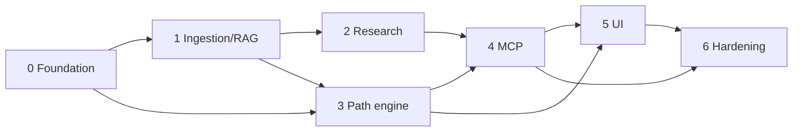

# My LMS — Implementation Plan

Sources: [design](../lms/README.md) · [UI demo](../lms/preview.html)

## Ground rules

- **Demo data is mock.** Raft/Go subject, "minh", 94.2% retention, 3/8 nodes, the debate transcript, the SRS rows, the 3 BYOS files, the `alert()` calls and the `[FSRS curve]` placeholder must **not** be copied. Every screen renders data from the DB and needs a real empty state. Only the visual structure, CSS tokens and interaction flow are taken from the demo.
- **Follow existing conventions** (`src/lib/db.ts` `Db` interface, `ownerId` = `string` and `''` in open mode, `migrations/NNN_*.sql`, PGlite tests via `setDbForTests`, `node --import tsx --test`, Tailwind v4, `lucide-react` icons, `src/lib/auth`, `src/lib/audit.ts`).
- **Pure logic first.** Binary search, SRS, DAG validation and chunking are pure functions, unit-tested before any route or UI uses them.
- Each task lists files, acceptance criteria and dependencies. Each phase ends in a shippable state.

## Findings that affect the plan

1. ✅ **DONE — Standalone agent skills & local workflow** (design §8 Phase 1). The 6 `lms-*` skills, the state machine, installer, CLI and tests are released at [nnminm-sam/agentic-workflows `.agents/skills`](https://github.com/nnminh-sam/agentic-workflows/tree/main/.agents/skills) (`lms-research-document`, `lms-validate-research`, `lms-aggregate-sources`, `lms-design-learning-path`, `lms-validate-learning-path`, `lms-teaching-orchestrator`). They are not in this repo and are **not** re-planned. Its zero-dependency [`workflow.ts`](https://github.com/nnminh-sam/agentic-workflows/blob/main/.agents/skills/lms-teaching-orchestrator/scripts/workflow.ts) already has the pure logic (`submitResearchDraft`, `validateResearchDraft`, `resolveResearchEscalation`, `chunkMarkdownByHeadings`, `startPlacementQuiz`/`submitPlacementQuizStep`, `detectDagCycles`/`validateLearningPath`, `computeNextSpacedRepetition`, `submitNodeQuizAttempt`). Phases 0, 2 and 3 therefore **port and adapt** that logic (and its test cases from `workflow.test.ts`) into `src/lib/lms/` over the DB instead of writing it from scratch. Keep behaviour compatible so the skills and the web app agree.
2. `src/app/(workspace)/learning/page.tsx` is an empty stub, and `/learning` is already in `src/lib/navigation.ts`. The nav needs no change.
3. No `pgvector`, file-parser, embedding, or MCP-server dependency exists yet. `@ai-sdk/mcp` is client-only. Neon HTTP driver supports `pgvector`.
4. `src/proxy.ts` already accepts a bearer token and cookie. `/api/mcp` must use the same auth path (check `bearerToken` handling).

## Status

| Item | Status |
|---|---|
| Design §8 Phase 1: standalone agent skills + local workflow (external repo) | ✅ Done |
| Plan phases 0–6 below (all work inside `my_kaneki`) | ⬜ Not started |

## Phases

| # | Doc | Outcome | Depends on |
|---|-----|---------|-----------|
| 0 | [00-foundation.md](00-foundation.md) | Migration, types, repo layer, pure algorithms + tests | — |
| 1 | [01-ingestion-rag.md](01-ingestion-rag.md) | BYOS parsers, GitHub sync, chunking, embeddings, `searchRag` | 0 |
| 2 | [02-research-loop.md](02-research-loop.md) | Track 2 research/validation state machine with 3-round cap + escalation | 0, 1 |
| 3 | [03-path-engine.md](03-path-engine.md) | Placement, DAG drafting + validation, mastery gates, SRS services | 0, 1 |
| 4 | [04-mcp-server.md](04-mcp-server.md) | `/api/mcp` Streamable HTTP server: resources, tools, prompts | 1–3 |
| 5 | [05-learner-ui.md](05-learner-ui.md) | `/learning` UI (6 views from demo), server actions/API | 0, 3 (4 for agent chat) |
| 6 | [06-hardening.md](06-hardening.md) | Agent wiring, observability, e2e tests, docs, rollout | all |

Phases 2 and 3 can run in parallel after Phase 1. Phase 5 UI can start against Phase 3 services before Phase 4 finishes.

## Demo → real-feature map

| Demo view (`tab-*`) | Real data source | Phase |
|---|---|---|
| Header: subject pill, persona badges, progress/SRS chips | `lms_subjects`, `lms_learner_profiles`, computed stats | 5 |
| `tab-dag` Learning Path, placement banner, capstone banner | `lms_nodes`, `lms_node_edges`, `lms_placement_sessions`, `lms_subjects.capstone_project` | 5 |
| `tab-reader` Study guide + tutor sidekick | `lms_nodes.github_md_path` (GitHub markdown), chat via existing `/api/chat` + LMS tools | 5, 6 |
| `tab-quiz` Mastery gate | `lms_quizzes` (all 4 modalities, not only MCQ) | 3, 5 |
| `tab-srs` Daily review | `lms_spaced_repetition` | 3, 5 |
| `tab-research` Debate | `lms_sources.debate_history`, `review_round` | 2, 5 |
| `tab-ingest` BYOS hub | `lms_sources` where `track='byos'` | 1, 5 |

## Open questions

1. Embedding provider/model (design says `vector(1536)`; the app uses an Ollama-compatible provider, so confirm one that has an embeddings endpoint).
2. ~~Is `.agents/skills/lms-*` supposed to exist?~~ Resolved: released externally (Finding 1). Remaining question: vendor/copy the logic into `src/lib/lms/` (assumed) or consume it as a package?
3. Code challenge execution (Phase 3, T3.7): LLM/rubric-only for v1, or a sandboxed runner? The plan assumes **rubric-only v1**.
4. Multi-user or single-owner? Existing code uses `owner_id`; the plan scopes every table by `owner_id`.
5. FSRS vs. SM-2: the plan implements the **SM-2 formula given in §6.2**; FSRS is left as an extension behind the same interface.
