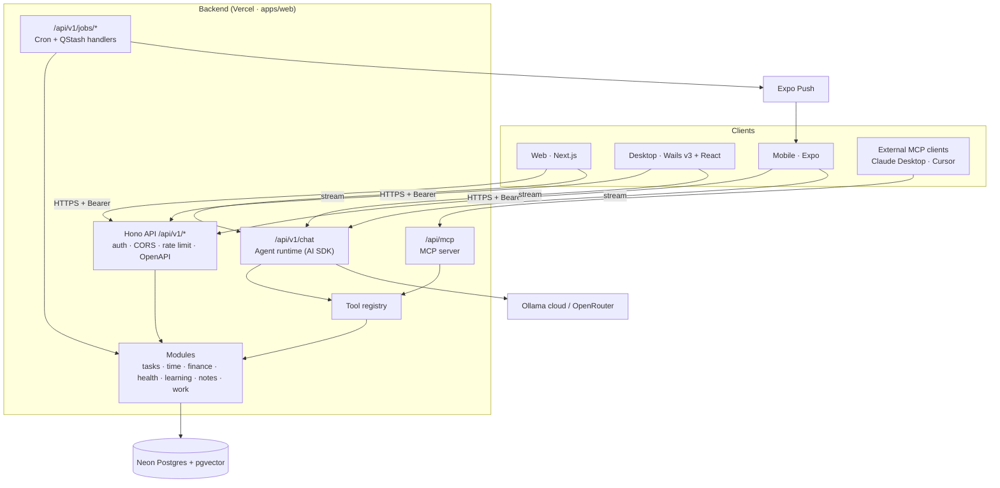
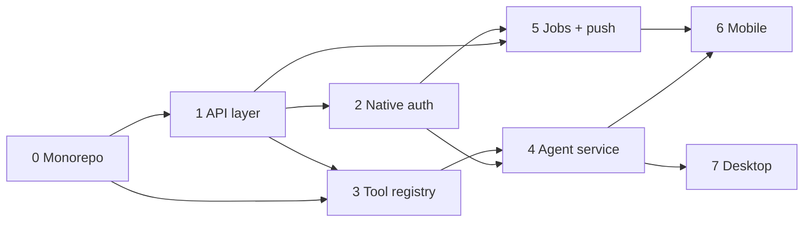

# my_kaneki Platform — Multi-client Personal Assistant Plan

Status: **planned** · Decided 2026-11-26 · Supersedes nothing (the LMS plan in [`docs/plan/`](../plan/README.md) continues as one module of this platform).

## Goal

Grow my_kaneki from one serverless Next.js web app into a **personal AI assistant platform** with three clients — web, desktop, mobile — on **one shared backend**. The assistant is the main way to use the app: it chats on cloud models (Ollama cloud / OpenRouter, as today) and drives every feature through tool calls. Features ship as small **modules** (tasks, time, finance, work, health, learning, notes, …) that are added over time as needs appear.

## Locked decisions

| Area | Choice | Why |
|---|---|---|
| Web client | **Next.js** (current app) | Already built; keeps RSC for fast server pages. |
| Desktop client | **Wails v3** + Vite + React | Light: system webview + small Go binary. v3 brings tray, multi-window, global hotkeys. Reuses React code from web. |
| Mobile client | **Expo (React Native)** | Same TypeScript/React as the other clients; shares API client, zod schemas and AI SDK `useChat`. Chosen over Flutter (Dart would mean a second client codebase and a hand-written stream parser). |
| Backend framework | **Hono** + `@hono/zod-openapi` | Web-standard `Request`/`Response` (same as Next route handlers and AI SDK), mounts inside Next with one file, tiny cold starts, zod schemas become the OpenAPI contract, portable to Workers/Bun/Node later. Express is Node-only and untyped; NestJS is heavy on serverless and needs a rewrite into its DI model. |
| API contract | **OpenAPI 3.1**, generated from zod | Language-neutral (Go in Wails, any future client). TS clients are generated from it. |
| Agent location | **Server-side**, one agent for all clients | One place for provider keys, tools, history and audit. Clients only stream. |
| Tools | **One registry**, defined once per module | Same definition feeds the in-app agent, the MCP server and (optionally) REST. |
| Database | **Neon Postgres** + `pgvector` (current) | Already in use. |
| Hosting | **Vercel Hobby** (current) | Free for personal, non-commercial use. |
| Monorepo | **pnpm workspaces + Turborepo** | Shared packages across three apps. |

## Target architecture



### Target repository layout

```
apps/
  web/            Next.js app (today's src/), hosts the Hono API + MCP route
  desktop/        Wails v3: Go shell (main.go, tray, hotkey, keychain) + frontend/ (Vite + React)
  mobile/         Expo app (expo-router)
packages/
  core/           Db interface, auth primitives, shared utils (from src/lib/db.ts, src/lib/auth)
  api/            Hono app: middleware, route groups, OpenAPI document
  api-client/     Generated TS client (openapi-typescript + openapi-fetch) + chat transport helper
  agent/          Provider resolution (from src/lib/ai), system prompt composition, chat handler
  tools/          defineTools(), registry, adapters → AI SDK tools / MCP tools
  modules/
    tasks/        schema · service · tools · routes · migrations
    learning/     (today's src/lib/lms)
    notes/        (today's GitHub notes)
    …             time, finance, health, work as they are built
  ui/             Client-only React components shared by web + desktop (chat, markdown, cards)
migrations/       Stays global and ordered (NNN_*.sql); modules own their files by prefix
```

## Phases

| # | Doc | Outcome | Depends on |
|---|-----|---------|-----------|
| 0 | [00-monorepo.md](00-monorepo.md) | Monorepo with `apps/web` + shared packages; web still deploys unchanged | — |
| 1 | [01-api-layer.md](01-api-layer.md) | Hono API at `/api/v1`, OpenAPI spec, generated client, Bearer works everywhere | 0 |
| 2 | [02-native-auth.md](02-native-auth.md) | Access + refresh tokens, device sessions, CORS for native clients | 1 |
| 3 | [03-tool-registry.md](03-tool-registry.md) | Modules + one tool registry feeding agent and MCP | 0, 1 |
| 4 | [04-agent-service.md](04-agent-service.md) | `/api/v1/chat` for all clients, client-side tools, approvals | 2, 3 |
| 5 | [05-jobs-notifications.md](05-jobs-notifications.md) | Scheduled jobs, reminders, push notifications | 1, 2 |
| 6 | [06-mobile-expo.md](06-mobile-expo.md) | Expo app: login, chat, tasks, push, device tools | 2, 4, 5 |
| 7 | [07-desktop-wails.md](07-desktop-wails.md) | Wails app: chat, quick capture, tray, hotkey, notifications | 2, 4 |
| — | [module-guide.md](module-guide.md) | How to add a new feature module (checklist) | 3 |



Phases 6 and 7 can run in parallel. Phase 3 can start right after Phase 0 if the API work stalls. Each phase ends with the web app still working in production.

## Ground rules

- **The web app never breaks.** Every phase is deployable; old routes and Server Actions are removed only after their replacement is live and used.
- **Services are the source of truth.** Routes, Server Actions, agent tools and MCP tools are thin adapters over module service functions that take `ownerId` first. No business logic in adapters.
- **zod is the contract.** One schema per input/output, reused by API validation, OpenAPI, tool `inputSchema` and client types.
- **Every client authenticates with a Bearer token.** Cookies remain a web convenience only; nothing on the server may depend on cookies alone.
- **Owner scoping and audit stay.** Keep `owner_id text` (`''` in open mode), `src/lib/audit.ts` logging, PGlite tests via `setDbForTests`.
- **Free tier first.** Any new dependency on a paid service needs a note in this doc.

## Free hosting & limits

| Piece | Service | Limits that matter |
|---|---|---|
| Web, API, agent, MCP | Vercel Hobby | Personal/non-commercial only. Function max duration **300 s**. Cron at most **once per day** per job. |
| Database + vectors | Neon free | Fine for one user. |
| Timed jobs/reminders | Upstash QStash free | ~1,000 messages/day (pricing page was changing from 500; re-check). |
| Mobile push | Expo Push Service | Free. |
| LLM | Ollama cloud free tier / OpenRouter `:free` models | OpenRouter: 20 req/min, **50 req/day unless ≥ $10 credits ever purchased** (then 1,000/day). One agent turn with tools = several requests. |
| Desktop releases | GitHub Releases | Free. |
| Mobile builds | Expo EAS free tier or local builds | Limited monthly cloud builds. |

**Unavoidable cost:** Apple Developer Program (**$99/year**) to keep the iOS app installed (free signing expires every 7 days) and to sign/notarize the macOS Wails app. Android sideloading and an unsigned Mac app on your own machine are free.

**Escape hatch:** if Vercel limits bite (long agent runs, frequent jobs), the Hono API moves to Cloudflare Workers, or Bun/Node on a small VPS, without code changes. Vercel Workflow is the in-platform option for long runs.

## Current state (2026-11-26) that this plan builds on

- 175 source files in `src/`; domain logic already in `src/lib/` over the `Db` interface, with PGlite tests.
- 14 pages read the database directly (RSC) and components call 4 Server Action files (`src/actions/{github,lms,settings,vercel}.ts`). Native clients can use neither → Phase 1.
- `src/proxy.ts` accepts `Authorization: Bearer`, but `currentOwnerId()` (`src/lib/owner.ts`) reads only the cookie, and is used in 32 files (10 API routes) → Phase 1, T1.1.
- Sessions are HS256 JWTs with a 2-hour sliding cookie (`SESSION_TTL_SECONDS`) — not suitable for native apps → Phase 2.
- Agent tools are defined twice: AI SDK tools in `src/lib/agent-tools.ts` + `src/lib/lms/lms-agent-tools.ts` (15 tools, camelCase) and MCP tools in `src/lib/lms/mcp-server.ts` (14 tools, snake_case), with different names and shapes → Phase 3.
- `/api/chat` has `maxDuration = 60`, merges my_pm_agent MCP tools at request time.
- my_finance and my_pm_agent are separate deployed apps, linked by URL / MCP.

## Open questions

1. **my_finance and my_pm_agent:** absorb them as modules in this monorepo, or keep them as external services connected via MCP? The plan assumes **external via MCP for now**, with a later migration per app.
2. **Wails v3 stability:** at the time of writing, sources disagreed on whether v3.0.0 is final or still beta ("API stable"). Check the GitHub releases before Phase 7; a late beta is acceptable for a personal app.
3. **Offline:** quick capture (tasks, expenses) on mobile probably needs an offline outbox. v1 assumes **online-only + a simple retry queue**; real sync (e.g. local SQLite + change log) is deferred.
4. **Package manager:** pnpm assumed. Confirm Expo's monorepo guide for the current pnpm linker setting before Phase 6.
5. **Realtime across devices:** v1 refetches on focus/poll; push-based updates are deferred.
