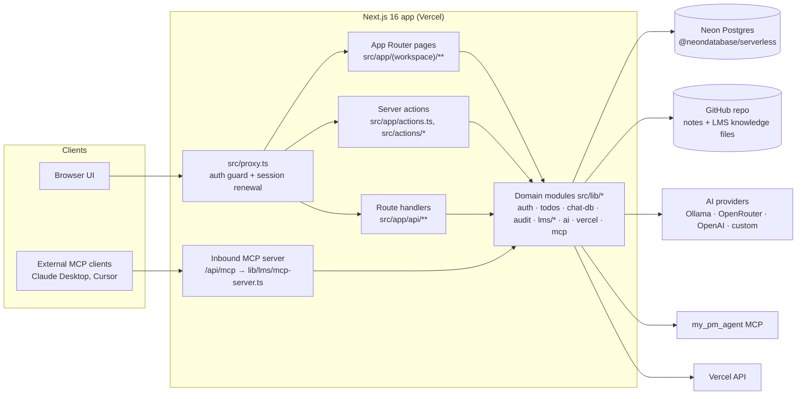
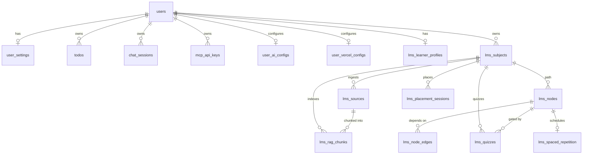
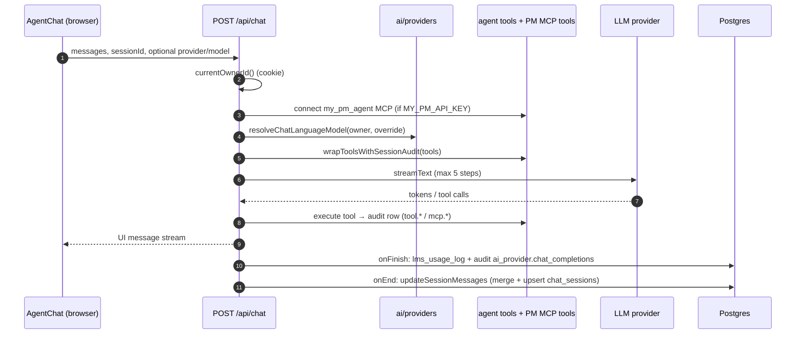
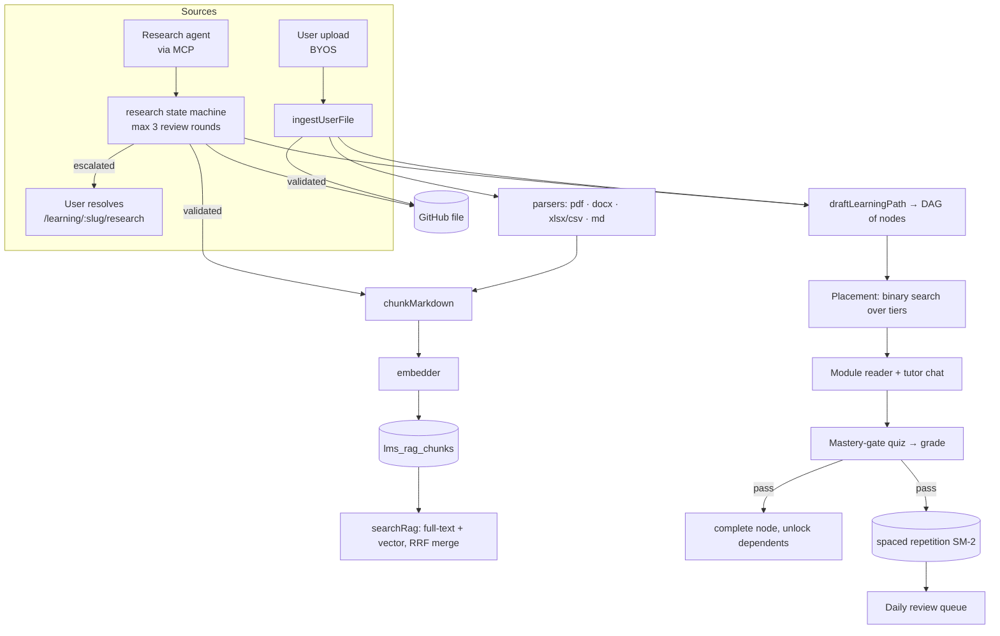

# my_kaneki — System Design

> Status: describes the code **as built** on `main` (Next.js app, single deployable).
> The multi-client platform in [`docs/platform/`](../platform/README.md) (Hono `/api/v1`, Expo, Wails, monorepo,
> jobs) is **planned, not built**. Where this document says "planned", it refers to that plan.
>
> Paths are relative to the repository root; `file:line` references point at the code that backs each statement.

## 1. What the system is

A personal **central workspace hub** for one owner (plus optional invited users), deployed as one Next.js app on
Vercel with a Neon Postgres database:

| Area | What it does |
| --- | --- |
| Agent chat | Tool-using AI assistant over the owner's data (todos, notes, LMS, deployments, `my_pm_agent`) |
| Todos | Simple task list |
| Notes | Markdown editor whose storage is a **GitHub repository** |
| Learning (LMS) | Self-learning system: sources → research/validation → learning-path DAG → placement → module study → mastery quizzes → spaced repetition |
| MCP server | Exposes the LMS to external agents (Claude Desktop, Cursor, …) over MCP |
| Deployments | Vercel dashboard: list deployments, build logs, redeploy |
| AI provider settings | Per-user chat/embedding provider config and MCP API keys |
| Audit log | Append-only record of tool calls, LLM steps and data mutations, viewable per chat session |

## 2. Architecture overview

### Layers

| Layer | Location | Role |
| --- | --- | --- |
| Edge guard | `src/proxy.ts` (Next 16 "proxy", formerly middleware) | Authenticates every non-static request, redirects pages to `/login?next=…`, returns 401 JSON for `/api/*`, renews the session cookie when it is close to expiry (`proxy.ts:17-31,60-73`). Skips `/api/auth/*` and `/api/mcp*`, which authenticate themselves (`:45`). |
| Pages | `src/app/(workspace)/**`, `src/app/login`, `src/app/signup` | Server components that load data through `src/lib/*` and render client components from `src/components/*`. |
| Server actions | `src/app/actions.ts` (auth, todos, theme), `src/actions/{github,lms,settings,vercel}.ts` | Mutations triggered by forms and buttons. |
| Route handlers | `src/app/api/**` | JSON/streaming endpoints: chat streaming, chat sessions, LMS uploads, MCP, audit query, usage, Vercel. |
| Domain modules | `src/lib/**` | All business logic and SQL. Every function takes an explicit `ownerId`. |
| Data access | `src/lib/db.ts` | Minimal `Db` interface (`query`, `transaction`). Runtime uses Neon's HTTP driver on `DATABASE_URL`; scripts use `DATABASE_URL_UNPOOLED` (`db.ts:33-50`). Tests swap in PGlite via `setDbForTests` (`:28`). |

## 3. Authentication & authorization

### Auth modes (`src/lib/auth/index.ts:27-30`)

| Mode | When | Behaviour |
| --- | --- | --- |
| `jwt` | `JWT_SECRET` set and ≥ 32 chars | Normal login; data scoped per user |
| `open` | No secret, not on Vercel (local dev) | No login; owner id is `""` |
| `locked` | Secret too short, or no secret on Vercel | Only `/login` and `/signup` reachable; everything else denied (`proxy.ts:40-43`) |

### Sessions
- Hand-rolled **HS256 JWT** on `node:crypto`, issuer `my_kaneki`, **2 h TTL**, renewed when < 1 h is left,
  hard cap **30 days** from `auth_time`; constant-time signature compare (`src/lib/auth/jwt.ts`).
- Carried in the httpOnly, `sameSite=lax` cookie `kaneki_session`, or as `Authorization: Bearer` (checked first)
  (`index.ts:21,46-48,94-106`).
- Passwords: **scrypt**; login hashes against a dummy hash for unknown emails to equalise timing
  (`users.ts:162`).

### Sign-up policy (`src/lib/auth/users.ts:120-153`)
The first user can always sign up (becomes the owner). Afterwards only emails in `KANEKI_SIGNUP_EMAILS` may sign up
(status *invite*); otherwise sign-up is closed (403). There are no roles — every user is a separate owner.

### MCP authentication (`index.ts:127-174`, `src/lib/auth/api-keys.ts`)
Checked in order: (1) database API key `knk_…` (SHA-256 hash lookup; `last_used_at` updated),
(2) static `KANEKI_MCP_API_KEY` mapped to `KANEKI_MCP_OWNER_ID` (timing-safe), (3) open mode, (4) JWT bearer/cookie.
Keys are `knk_` + 48 hex chars; only the hash and a display prefix are stored and the raw key is shown once.
`/api/mcp` also rejects cross-origin requests whose `Origin` doesn't match `Host` (DNS-rebinding guard,
`api/mcp/route.ts:14-31`) and audits failures as `lms.mcp.auth_failure`.

### Owner isolation
Enforced **in application code** (no Postgres row-level security): every query filters `owner_id = $n`
(e.g. `todos.ts:73`), and LMS child tables are reached through a join on `lms_subjects.owner_id`
(`lms/repo.ts:367-370`, `lms/rag.ts:198-200`).

## 4. Data model

All tables are created by `migrations/001…011` (applied by `src/lib/migrate.ts`); three are additionally created
lazily at runtime with `create table if not exists`.

`owner_id` columns are plain text (not foreign keys); `""` means open mode. The diagram shows logical ownership.

| Domain | Table | Key facts | Owning module |
| --- | --- | --- | --- |
| Users & auth | `users` | id `U-<n>` from a sequence, unique email, scrypt hash | `lib/auth/users.ts` |
| | `user_settings` | theme `light`/`dark`/`system`, FK → users (cascade) | `lib/settings.ts` |
| | `mcp_api_keys` | `mk_…` id, name, `key_prefix`, `key_hash` (unique), `last_used_at`, `revoked_at` — also runtime-created | `lib/auth/api-keys.ts` |
| Todos | `todos` | identity id, title, done, `completed_at`; index (owner, done, `created_at`) | `lib/todos.ts` |
| Chat | `chat_sessions` | id, title, `messages` = jsonb array of AI SDK `UIMessage`s | `lib/chat-db.ts` |
| Audit | `audit_log` | **append-only** (trigger raises on update/delete); action, entity_type/id, actor (`user` / `ai-agent`), payload jsonb; indexes on owner and `payload->>'sessionId'` | `lib/audit.ts` |
| LMS | `lms_learner_profiles` | PK owner_id; learner style | `lib/lms/repo.ts` |
| | `lms_subjects` | slug unique per owner; status `researching → placement → active → completed`; `difficulty_scale_n` (default 16); entry level; capstone jsonb | |
| | `lms_sources` | track `byos` / `agent_research`; validation `pending/in_review/validated/escalated_to_user/rejected`; `review_round` 0–3; `debate_history`; `file_sha`; `content_hash` | |
| | `lms_nodes` / `lms_node_edges` | path DAG; node status `locked/unlocked/in_progress/completed/mastered_by_placement`; self-edges blocked | |
| | `lms_rag_chunks` | chunk text + metadata; GIN full-text index; optional `embedding vector(1536)` + HNSW index (migration 006, skipped without pgvector) | `lib/lms/rag.ts` |
| | `lms_placement_sessions` | binary-search bounds and history | `lib/lms/placement.service.ts` |
| | `lms_quizzes` | purpose `placement/mastery_gate/spaced_repetition`; type `mcq_4/open_ended/code_challenge/project_task`; prompt payload, submission, score | `lib/lms/quiz.service.ts` |
| | `lms_spaced_repetition` | PK `node_id`; stability, difficulty, reps, lapses, interval, `next_review_at` | `lib/lms/review.service.ts` |
| | `lms_usage_log` | operation, model, tokens, cost estimate, duration | `lib/lms/usage.ts` |
| Integrations | `user_ai_configs` | chat/embedding provider + model, `providers` jsonb of credentials — also runtime-created | `lib/ai/providers.ts` |
| | `user_vercel_configs` | `api_token`, `team_id` — also runtime-created | `lib/vercel.ts` |
| Bookkeeping | `schema_migrations` | applied versions | `lib/migrate.ts` |

**Outside the database:** notes and LMS knowledge files (sources, module markdown, `metadata.json`) live in a GitHub
repository configured by `GITHUB_PAT` / `GITHUB_OWNER` / `GITHUB_REPO` / `GITHUB_BRANCH`.

## 5. AI chat & tools

- Route: `src/app/api/chat/route.ts` (`maxDuration = 60`). `consumeStream()` keeps the generation running if the
  browser disconnects (`:181`); errors are formatted for the user and audited with `status: "error"` (`:195-219`).
- **Provider resolution** (`lib/ai/providers.ts`): per-request override → owner's `user_ai_configs` row → `""`
  row → environment (`OLLAMA_*`, `OPENROUTER_*`, `OPENAI_API_KEY`). All providers go through
  `createOpenAICompatible`. OpenRouter `:free` models get a fallback `models` list, and 429/502/503 from OpenRouter
  fail over to Ollama when an Ollama key exists.
- **Tools** (`lib/agent-tools.ts`, `lib/lms/lms-agent-tools.ts`): workspace tools `addTodo`, `updateNote`,
  `getVercelDeployments`; LMS tools `lmsGetOrUpdateProfile`, `lmsCreateSubject`, `lmsGetSubjectOverview`,
  `lmsSearchKnowledge`, `lmsListSources`, `lmsIngestKnowledge`, `lmsDraftLearningPath`, `lmsGetNextNodes`,
  `lmsUpdateNodeStatus`, `lmsGenerateQuiz`, `lmsStartPlacement`, `lmsGetDueReviews`; plus all `my_pm_agent` MCP tools.
  Tools return `{ success: false, error }` instead of throwing.
- **Audit context**: `runWithAuditContext` uses `AsyncLocalStorage`, so audit rows written deep inside a tool inherit
  owner, session and tool-call ids (`lib/audit.ts:23-34,84-100`). Categories: `workspace_tool`, `lms_tool`,
  `mcp_api`, `llm_step`, `entity_mutation`.

## 6. LMS subsystem

| Stage | Implementation |
| --- | --- |
| Ingest (BYOS) | `lms/ingest.ts:42-166` — verify subject ownership, sanitise path to `lms/<slug>/sources/<file>`, commit bytes to GitHub + update `metadata.json`, upsert `lms_sources` as `validated`, extract text, index |
| Parsers | `lms/parsers/` — 50 MB limit; pdf (unpdf), docx (mammoth), xlsx/csv (≤ 500 rows/sheet), markdown/text |
| Chunking | `chunker.ts` — split on H1–H3 with heading breadcrumb, keep code fences/tables intact, ≤ 2000 chars |
| Embeddings | 1536-dim; OpenAI-compatible `/embeddings` client, or a deterministic SHA-256 fake when no key is configured |
| RAG | `rag.ts` — `indexSource` replaces a source's chunks in one transaction; `searchRag` checks ownership, runs `ts_rank` full-text (+ ILIKE) and, if the vector column exists, cosine search, merged with reciprocal-rank fusion (k = 60); vector failure falls back to text |
| Research | `research.ts`, `research-machine.ts` — pure state machine: submit draft → validate (accept / raise issues) → after 3 rounds `escalated_to_user`. The research and validation agents are **external MCP clients** driven by MCP prompts; the app itself calls no LLM here |
| Learning path | `dag.ts` (cycle detection, topo order, unlocked nodes), `path.service.ts` — only validated sources; module markdown written to GitHub; nodes below the entry level become `mastered_by_placement`; one transaction |
| Placement | `placement.ts` (binary search over tiers 1..N), `placement.service.ts` — requires a quiz for every tier (`PlacementBankIncompleteError`) |
| Quiz & grading | `quiz.service.ts`, `grading.ts` — answer keys stripped before reaching the client; MCQ exact match; open-ended/code via an LLM judge, pass ≥ 0.7; pass → node completed, dependents unlocked, SRS seeded; fail → node `in_progress` + targeted RAG excerpts |
| Spaced repetition | `srs.ts` — **SM-2** (EF min 1.3, default 2.5; grade < 3 = lapse, interval reset to 1 day). Column names say FSRS, the algorithm is SM-2 |

### Inbound MCP server (`/api/mcp`, `lib/lms/mcp-server.ts`)
Stateless Streamable-HTTP MCP server `my_kaneki_lms`; POST only (GET/DELETE → 405). A new server instance is
created per request for the authenticated owner.

| Group | Tools |
| --- | --- |
| A — Profile & subject | `lms_get_or_update_learner_profile`, `lms_create_subject` |
| B — Ingestion, research & validation | `lms_ingest_user_file`, `lms_start_research_session`, `lms_submit_research_draft`, `lms_validate_research_draft`, `lms_resolve_research_escalation`, `lms_search_rag` |
| C — Placement | `lms_placement_start`, `lms_placement_submit_step` |
| D — DAG & progression | `lms_draft_learning_path`, `lms_get_next_nodes` |
| E — Mastery & SRS | `lms_generate_quiz`, `lms_submit_quiz` |

Resources: `lms://profile`, `lms://subjects/{slug}/overview|graph`, `lms://subjects/{slug}/nodes/{nodeId}`,
`lms://reviews/due`. Prompts: `lms-orchestrate-research`, `lms-research-agent`, `lms-validate-agent`,
`lms-conduct-placement`, `lms-tutor-node`, `lms-daily-review`.

## 7. Other integrations

| Integration | Module | Config |
| --- | --- | --- |
| GitHub notes | `src/actions/github.ts` — tree, read, save with optimistic `baseSha` (409/422 → `CONFLICT`), rename/copy/delete as commits; `/api/notes/sync-status` polls with ETag/304 | `GITHUB_PAT`, `GITHUB_OWNER`, `GITHUB_REPO`, `GITHUB_BRANCH` |
| GitHub LMS files | `lib/lms/github-knowledge.ts` (60 s read cache) | same |
| Vercel | `lib/vercel.ts` — deployments, projects, build events, redeploy | per-user `user_vercel_configs`, else `VERCEL_ACCESS_TOKEN` / `VERCEL_TEAM_ID` |
| `my_pm_agent` (outbound MCP) | `lib/mcp.ts` — tools added to chat; silently skipped if not configured | `MY_PM_API_KEY`, `MY_PM_MCP_URL` |
| Usage dashboards | `/api/ollama/usage`, `/api/openrouter/usage` | provider keys |

## 8. Deployment & operations

- **Hosting**: Vercel (`vercel.json` sets the framework only). **Database**: Neon Postgres.
- **Migrations** are not part of the build: run `npm run db:migrate` (Neon WebSocket client on the unpooled URL;
  each file in its own transaction under an advisory lock, recorded in `schema_migrations`). `npm run db:smoke`
  checks connectivity.
- **Environment**: `DATABASE_URL`, `DATABASE_URL_UNPOOLED`, `JWT_SECRET`, `KANEKI_SIGNUP_EMAILS`, GitHub, Vercel,
  `my_pm_agent` and AI-provider variables (see `.env.example`). Provider keys can also be set per user in the UI.
- **Tests**: `node:test` via `tsx`; database tests run on in-memory **PGlite** with the real migrations, with fakes
  for embeddings and the LLM judge.
- **Design system**: Storybook (`npm run storybook`) documents tokens, class recipes and components.

## 9. Known gaps (as of this writing)

| Gap | Evidence |
| --- | --- |
| LMS daily rate limits are defined but never enforced | `assertRateLimit` (`lib/lms/usage.ts:129`) has no callers |
| Only a mock LLM judge exists (length heuristic) | `createMockLlmJudge` is the default (`lib/lms/grading.ts:26-58`) |
| Routes using `currentOwnerId()` accept the cookie only, not a Bearer token | `lib/owner.ts:5-11`; e.g. `/api/chat` |
| GitHub notes are shared across owners (one repo from env, no owner check) | `src/actions/github.ts` |
| Provider API keys and the Vercel token are stored unencrypted | `user_ai_configs.providers`, `user_vercel_configs.api_token` |
| Inbound MCP tool calls are not session-audited per tool (only repo-level audit rows) | `lib/lms/mcp-server.ts` |
| `getLmsMcpTools` is unused | `lib/mcp.ts:63` |

## 10. Planned evolution

See [`docs/platform/README.md`](../platform/README.md): a pnpm/Turborepo monorepo with a Hono `/api/v1` (OpenAPI),
native auth, one shared tool registry, a server-side agent service, jobs & notifications, an Expo mobile client and a
Wails desktop client. None of it exists in the code yet.
