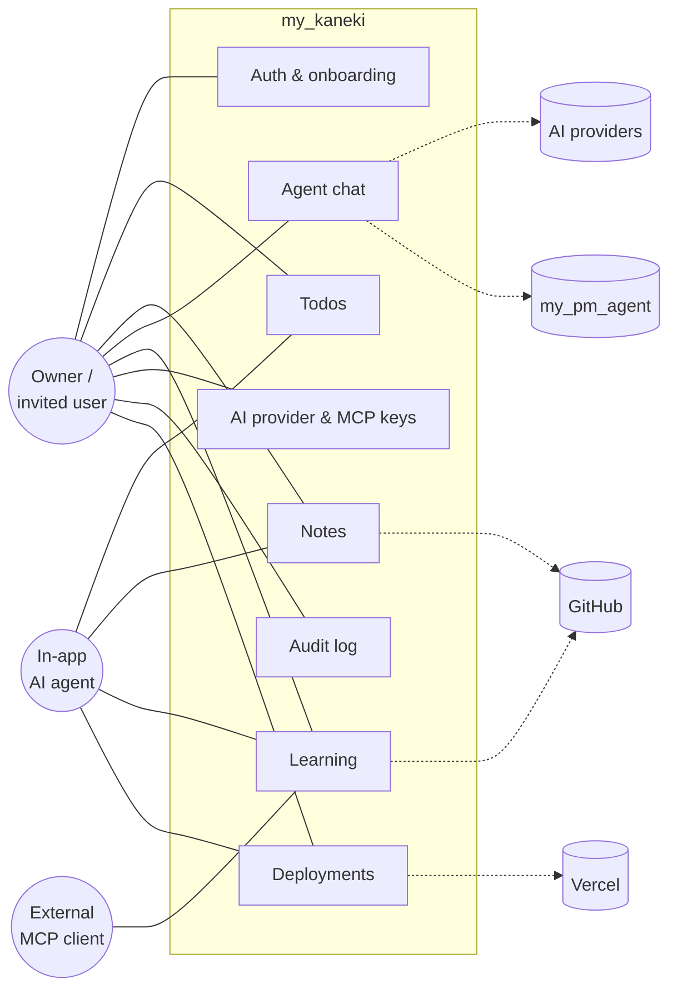
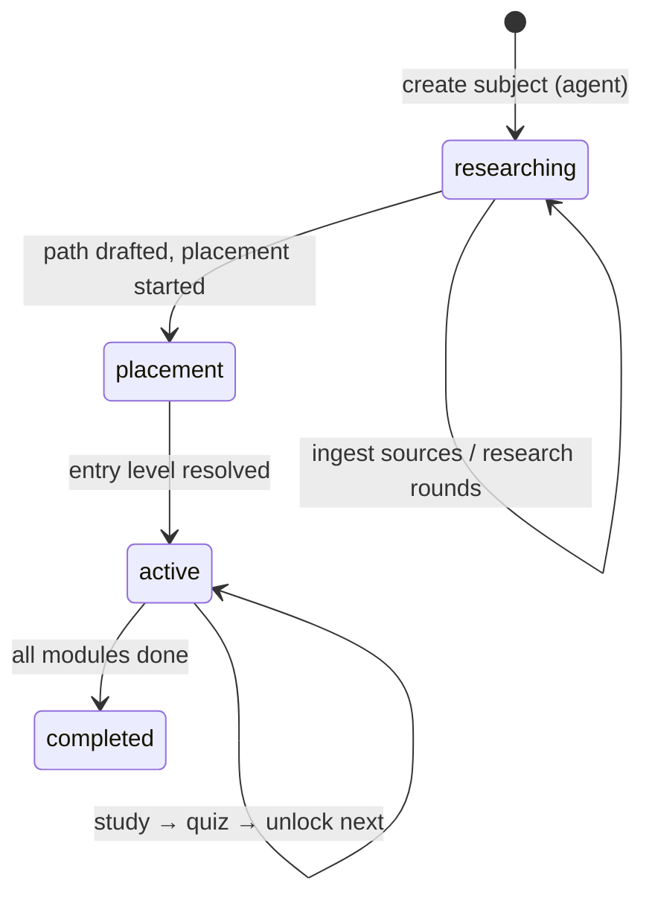

# my_kaneki — Use Cases

> Describes what the **current code** lets each actor do. Companion to [system-design.md](./system-design.md).
> Planned features from [`docs/platform/`](../platform/README.md) are listed at the end and are not built.

## Actors

| Actor | Description |
| --- | --- |
| **Owner** | The first account to sign up. Uses every page. In local *open* mode there is no login and the owner id is `""`. |
| **Invited user** | Can sign up only if their email is in `KANEKI_SIGNUP_EMAILS`. Same capabilities as the owner, over their own data — no roles or admin. |
| **AI agent (in-app)** | The chat assistant at `/`. Acts for the signed-in user through tools; its writes are audited with actor `ai-agent`. |
| **External MCP client** | Claude Desktop, Cursor, etc. calling `POST /api/mcp` with a `knk_…` API key. LMS only. |
| **External systems** | GitHub (notes + LMS files), Vercel API, `my_pm_agent` MCP, AI providers (Ollama, OpenRouter, OpenAI, custom). |

## Navigation map

| Route | Page | Purpose |
| --- | --- | --- |
| `/login`, `/signup` | auth forms | Sign in / sign up (shows open / invite / closed status) |
| `/` | Agent | Chat with the AI agent; session list |
| `/learning` | Learning | Onboarding when there are no subjects, else redirect to the first subject |
| `/learning/[slug]` | Learning path | DAG of modules, placement and capstone banners |
| `/learning/[slug]/graph` | Presentation graph | Mermaid view of the path |
| `/learning/[slug]/module/[nodeId]` | Active module | Module markdown + tutor chat |
| `/learning/[slug]/quiz/[quizId]` | Mastery gate quiz | Quiz runner (placement or mastery gate) |
| `/learning/[slug]/review` | Daily spaced repetition | Due reviews |
| `/learning/[slug]/research` | Agent research & debate | Research drafts, validation rounds, escalations |
| `/learning/[slug]/sources` | BYOS knowledge hub | Upload and manage sources |
| `/todos` | Todo & planning | Todo list with open/all tabs and search |
| `/notes` | Notes | GitHub-backed markdown editor |
| `/deployments` | Deployments | Vercel dashboard |
| `/ai-provider` (`/settings` redirects) | AI provider | Providers, models, MCP API keys |
| `/audit` | Audit log | Per-session telemetry |

Sidebar order comes from `src/lib/navigation.ts:25-75`; the learning sub-navigation from
`src/components/lms/lms-nav-items.ts`.

---

## A. Authentication & onboarding

### UC-A1 Sign up
- **Actor:** visitor · **Trigger:** `/signup`
- **Main flow:** form → `signUp` action (`src/app/actions.ts:37`) → validate email/password policy and allowlist
  (`lib/auth/users.ts:131-153`) → scrypt hash, insert `users` → issue session cookie → redirect to `next`.
- **Alternate:** `invalid_email`, `invalid_password`, `password_mismatch`, `email_taken` (409),
  `signup_closed` (403) when the user is not first and not on the allowlist. Outside `jwt` mode the form redirects back.
- **Data:** `users`

### UC-A2 Log in
- **Actor:** owner / user · **Trigger:** `/login` (or `POST /api/auth/login` for a JSON token)
- **Main flow:** `login` action → `logIn` (scrypt verify, dummy-hash timing equalisation) → cookie → redirect.
- **Alternate:** `invalid_credentials`.

### UC-A3 Stay signed in / be redirected
- **Actor:** system (`src/proxy.ts`) · every request
- **Flow:** valid session → pass (renewed if < 1 h left); no session → page redirects to `/login?next=…`, API returns 401.
  Sessions end after 30 days regardless.

### UC-A4 Log out — sidebar form → `logout` clears the cookie.

### UC-A5 Who am I — `GET /api/auth/me`.

## B. Todos

### UC-T1 Add a todo
- **Actors:** user (`/todos` form) or AI agent (`addTodo` tool)
- **Flow:** `addTodoAction` → `addTodo` (`lib/todos.ts:39-68`) writes the todo **and** an `audit_log` row
  `todo.create` in one transaction.
- **Alternate:** empty title ignored; length capped.
- **Data:** `todos`, `audit_log`

### UC-T2 Complete / reopen — checkbox → `toggleTodoAction` → `setTodoDone` sets `completed_at`. Not audited.

### UC-T3 Filter & search — tabs `?view=todo|all`, search `?q=` (case-insensitive). DB failure shows an error state.

*Not supported:* editing or deleting todos.

## C. Notes (GitHub-backed)

### UC-N1 Browse notes — `checkBranch` → `getRepoTree` → `FileTree`. Missing GitHub env → `CONFIG` error state.

### UC-N2 Read / preview a note — `getNote`; editor offers edit, preview and split modes (`MarkdownPreview`).

### UC-N3 Create or save a note
- **Actors:** user, or AI agent (`updateNote` tool)
- **Flow:** `saveNote(path, content, baseSha)` commits to GitHub → audit `note.create` / `note.update` after the commit.
- **Alternate:** `CONFLICT` (stale sha — someone changed the file), `RATE_LIMITED`, `UNAUTHORIZED`, `NOT_FOUND`,
  `INVALID_PATH`.
- **Data:** GitHub repo, `audit_log`

### UC-N4 Rename / move / copy / delete — confirmed in `ActionModal`; each is a GitHub commit.

### UC-N5 Detect remote changes — the editor polls `/api/notes/sync-status?path&sha` (ETag / 304) and warns when the
file changed on GitHub.

## D. Agent chat

### UC-C1 Chat with the agent
- **Actor:** user · **Trigger:** send a message at `/` (or in the module tutor)
- **Flow:** `AgentChat` → `POST /api/chat` with `sessionId` and an optional model override from `ModelSwitcher` →
  model resolved → tools (workspace + LMS + `my_pm_agent`) wrapped with audit → streamed answer with tool cards →
  usage + audit rows → session messages saved.
- **Alternate:** provider error is shown in the chat and audited with `status: "error"`; OpenRouter overload fails
  over to Ollama when configured; generation continues server-side if the tab closes.
- **Data:** `chat_sessions`, `audit_log`, `lms_usage_log`

### UC-C2 Manage sessions — list, create, rename, delete, load older messages (`/api/chat/sessions*`, paged with
`?limit&before`). Also mirrored to localStorage.

### UC-C3 Check provider usage — usage modal reads `/api/ollama/usage`, `/api/openrouter/usage`.

## E. AI provider settings & MCP keys

### UC-P1 Configure providers — choose chat provider/model and embedding provider/model, enter keys, base URLs and
preferred models → `saveAiSettingsAction` → `user_ai_configs` + audit `ai.config.update`. Keys are masked when shown.
Environment keys are the fallback.

### UC-P2 Override the model for a message — `ModelSwitcher` in the chat input.

### UC-K1 Create an MCP API key — `generateMcpApiKeyAction` → `knk_…` shown **once**; only hash + prefix stored;
audit `mcp.api_key.create`.

### UC-K2 Revoke an MCP API key — audit `mcp.api_key.revoke`.

### UC-K3 Use the MCP server (external client)
- **Flow:** `POST /api/mcp` with `Bearer knk_…` → Origin check → key → owner → per-request MCP server → LMS tool runs
  for that owner.
- **Alternate:** bad/revoked key → 401 + audit `lms.mcp.auth_failure`; GET/DELETE → 405.

## F. Learning (LMS)

The learning journey for one **subject**:

### UC-L1 Create a subject
- **Actors:** AI agent (`lmsCreateSubject`) or MCP client (`lms_create_subject`). **There is no UI form** — the
  empty state (`NoSubjectsOnboarding`) points the user to the agent.
- **Data:** `lms_subjects` (status `researching`), audit `lms.subject.create`

### UC-L2 Set learner profile — learning style/pace/depth via `lmsGetOrUpdateProfile` / `lms_get_or_update_learner_profile`.

### UC-L3 Bring your own source (BYOS)
- **Actors:** user (`/learning/[slug]/sources`), AI agent (`lmsIngestKnowledge`), MCP client (`lms_ingest_user_file`)
- **Flow:** upload (multipart) → file committed to GitHub + `metadata.json` → `lms_sources` row (`validated`) →
  text extracted (pdf, docx, xlsx/csv, markdown) → chunked → embedded → `lms_rag_chunks`.
- **Alternate:** unknown subject, invalid filename (400), file > 50 MB, upload failure (500).

### UC-L4 Delete a source — removes DB rows, the GitHub file and its metadata entry.

### UC-L5 Research & validate knowledge (multi-agent debate)
- **Actors:** external research + validation agents (MCP), user for escalations
- **Flow:** `lms_start_research_session` → `lms_submit_research_draft` (citations checked) →
  `lms_validate_research_draft` (accept / raise issues) → repeat; accepted drafts are committed to GitHub and indexed.
- **Escalation:** after **3** rounds without agreement the source is `escalated_to_user`; the user resolves it at
  `/learning/[slug]/research` (approve, edit & approve, or reject).

### UC-L6 Draft the learning path — `lmsDraftLearningPath` / `lms_draft_learning_path`: requires validated sources;
the DAG is validated (no cycles, valid prerequisites); module markdown goes to GitHub. Viewed at `/learning/[slug]`
and `/graph`.

### UC-L7 Take the placement test
- **Actor:** user (`PlacementBanner` → Start), or agent (`lmsStartPlacement`)
- **Flow:** binary search over difficulty tiers (1..16): each answered quiz narrows the range → resolved entry level →
  lower modules become `mastered_by_placement`, subject becomes `active`.
- **Alternate:** missing placement quiz for some tier → `PlacementBankIncompleteError`.

### UC-L8 Study a module — `ModuleReader` shows the module markdown from GitHub; `TutorSidekick` is a Socratic tutor
chat scoped to the module.

### UC-L9 Pass a mastery-gate quiz
- **Flow:** agent generates the quiz (`lmsGenerateQuiz`) → user answers in `QuizRunner` (answer key never sent to the
  browser) → graded (MCQ exact; open-ended/code by LLM judge, pass ≥ 0.7).
- **Pass:** module `completed`, dependents unlocked, first review scheduled for +1 day.
- **Fail:** module stays `in_progress`; targeted excerpts from the knowledge base are returned.

### UC-L10 Daily spaced-repetition review — `/learning/[slug]/review` lists due modules; each review reschedules with
SM-2.

### UC-L11 Search the knowledge base — `lmsSearchKnowledge` / `lms_search_rag`: hybrid full-text + vector search,
owner-scoped.

## G. Audit

### UC-AU1 Inspect a session's telemetry — `/audit` (and `GET /api/audit?sessionId&category&status&search`) shows
tool calls, MCP calls, LLM steps and entity mutations for a chat session.

Audited actions include `todo.create`, `note.create|update`, `tool.*`, `mcp.*`, `ai_provider.chat_completions`,
`ai.config.update`, `mcp.api_key.create|revoke`, `vercel.config.update|clear`, `vercel.deployment.redeploy`,
`lms.profile.upsert`, `lms.subject.create|update_status`, `lms.source.create`, `lms.research.*`,
`lms.mcp.auth_failure`. Rows can never be updated or deleted.

## H. Deployments (Vercel)

### UC-D1 Connect Vercel — save token + team (`user_vercel_configs`), or rely on env.
### UC-D2 View deployments — by project (`my_kaneki`, `my_finance`, `my_pm_agent`), state and target. Also via the agent
(`getVercelDeployments`, read-only).
### UC-D3 Read build logs — deployment events.
### UC-D4 Redeploy — re-trigger a deployment (can target production); audited `vercel.deployment.redeploy`.

## I. Personalisation

### UC-S1 Switch theme — light / dark / system; saved in a 1-year cookie and, when signed in, `user_settings`.

---

## Who can do what

| Use case | UI | In-app agent | MCP client |
| --- | :-: | :-: | :-: |
| Sign up / log in / theme / provider settings / API keys / Vercel config & redeploy | ✓ | | |
| Add todo | ✓ | ✓ | |
| Complete todo | ✓ | | |
| Create / update note | ✓ | ✓ | |
| Rename / copy / delete note | ✓ | | |
| View deployments | ✓ | ✓ | |
| Create subject, learner profile | | ✓ | ✓ |
| Ingest source | ✓ | ✓ | ✓ |
| Research drafts & validation | | | ✓ |
| Resolve research escalation | ✓ | | ✓ |
| Draft learning path, generate quiz | | ✓ | ✓ |
| Start placement | ✓ | ✓ | ✓ |
| Answer quiz / placement step | ✓ | | ✓ |
| Search knowledge base | | ✓ | ✓ |
| Due reviews | ✓ | ✓ | ✓ (resource) |

## Not built yet (planned in `docs/platform/`)

Hono `/api/v1` with OpenAPI, native-app auth, a single shared tool registry, a server-side agent service, jobs &
notifications (cron, QStash, Expo push), an Expo mobile client, a Wails desktop client, a pnpm/Turborepo monorepo, and
new modules (time, finance, health, work).
